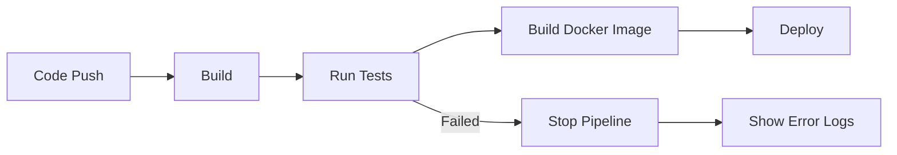

# فصل پنجم – Test Cases & CI/CD Pipeline

## 1. طراحی پنج Test Case

در این پروژه یک API ساده مدیریت کاربران (User Management API) را در نظر می‌گیریم.

| شماره | Test Case | ورودی | نتیجه مورد انتظار |
|---|---|---|---|
| 1 | Valid Login | نام کاربری و رمز عبور صحیح | ورود موفق کاربر |
| 2 | Invalid Login | اطلاعات ورود اشتباه | نمایش خطای احراز هویت |
| 3 | Create User | اطلاعات معتبر کاربر | ایجاد حساب کاربری |
| 4 | Invalid Input | فیلدهای خالی هنگام ثبت‌نام | نمایش خطای اعتبارسنجی |
| 5 | API Response | ارسال درخواست به API | دریافت پاسخ HTTP 200 |

## 2. طراحی CI/CD Pipeline

CI/CD مخفف Continuous Integration و Continuous Delivery/Deployment است.

مراحل اجرای Pipeline:

1. **Code Push:** ارسال کد به Repository.
2. **Build:** ساخت و بررسی اولیه پروژه.
3. **Run Tests:** اجرای تست‌های خودکار.
4. **Build Docker Image:** ساخت Image از پروژه.
5. **Deploy:** انتشار نسخه نهایی برنامه.

### نمودار Pipeline

## 3. مرحله شکست Test

برای مثال، اگر Test Case شماره 2 یعنی Invalid Login شکست بخورد، مرحله Run Tests با خطا مواجه می‌شود.

در این شرایط:
- Pipeline متوقف می‌شود.
- گزارش خطا و جزئیات تست ناموفق نمایش داده می‌شود.
- مراحل بعدی مانند ساخت Image نهایی و Deploy اجرا نمی‌شوند.
- پس از اصلاح کد، Pipeline مجدداً اجرا می‌شود.

## 4. ارتباط Docker با CI/CD Pipeline

Docker به Pipeline کمک می‌کند تا برنامه در یک محیط یکسان و قابل تکرار اجرا شود.

کاربرد Docker در این فرآیند:

- ایجاد محیط مستقل برای اجرای برنامه.
- جلوگیری از تفاوت محیط توسعه و محیط اجرا.
- اجرای تست‌ها در محیطی مشابه محیط نهایی.
- ساخت Docker Image برای انتشار برنامه.
- انتقال آسان برنامه به سرور یا محیط Production.

### نتیجه‌گیری

ترکیب Test Cases، CI/CD و Docker باعث افزایش کیفیت نرم‌افزار، شناسایی سریع خطاها و ساده‌تر شدن فرآیند انتشار نسخه‌های جدید می‌شود.
